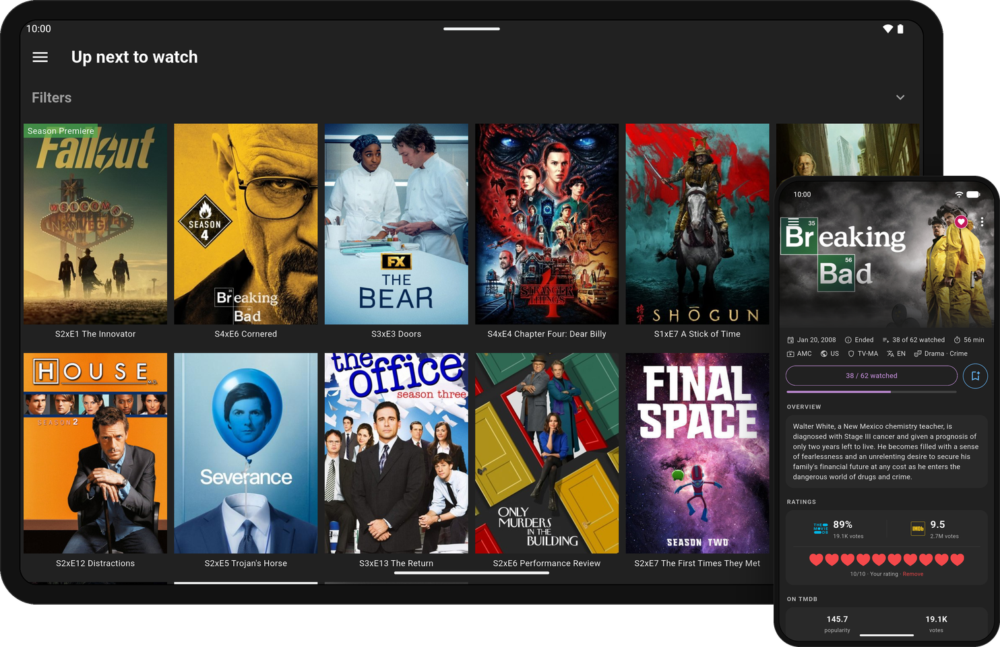
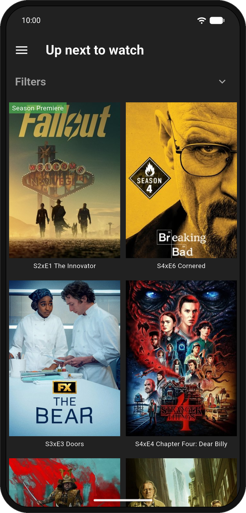
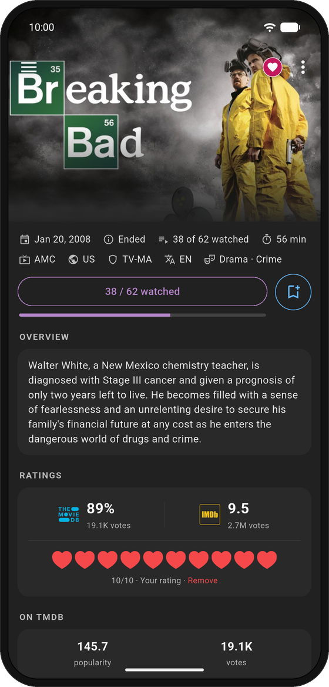
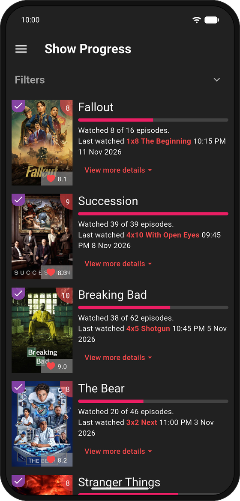
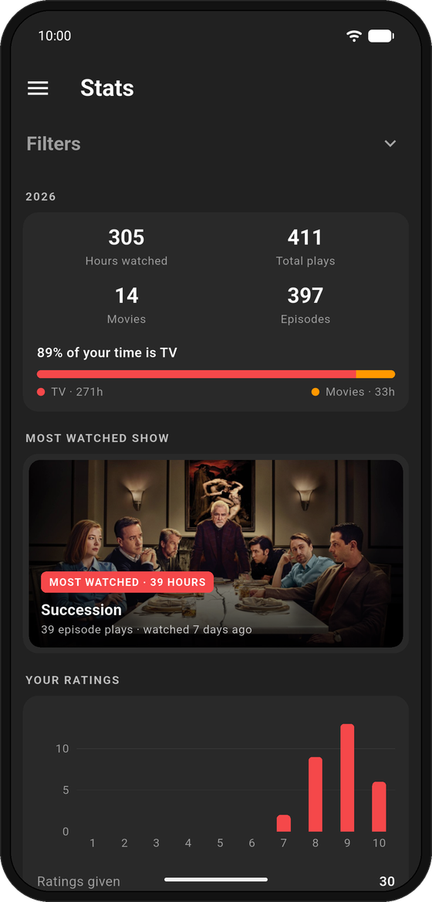
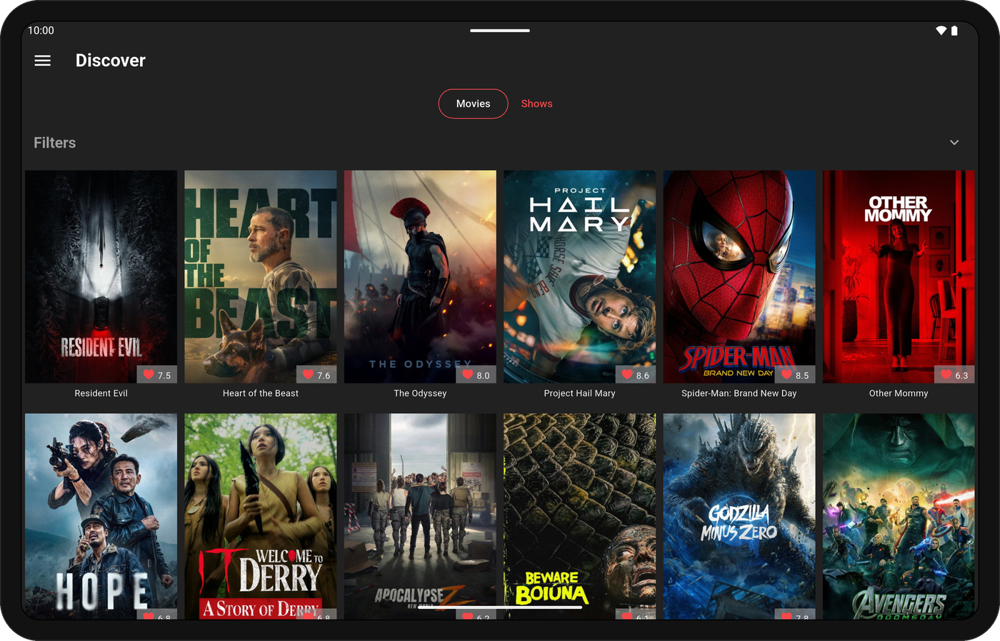
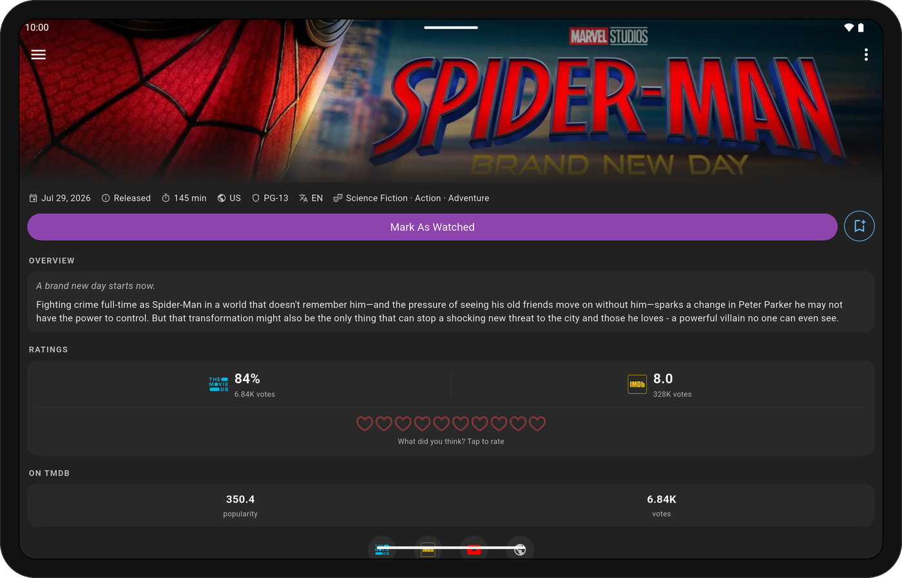
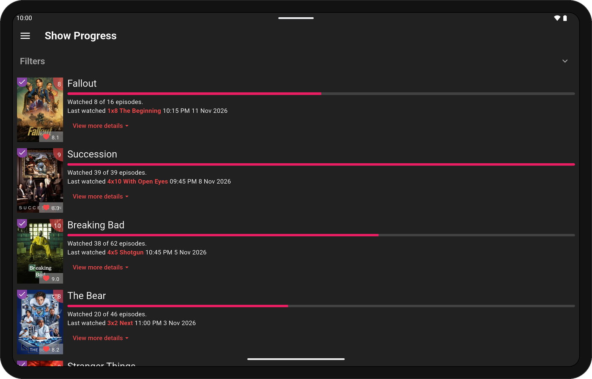

<p align="center">
  
</p>

<h1 align="center">Ticket Box</h1>

<p align="center">
  Track your shows and movies on your Android phone or tablet.<br>
  No account, no ads, and your data stays on your device.
</p>

<p align="center">
  <a href="https://play.google.com/store/apps/details?id=ro.madcodestudios.ticket.box">Google Play</a> ·
  <a href="https://ticket-box.madcodestudios.ro/">Website</a> ·
  <a href="https://www.reddit.com/r/ticketboxapp/">Reddit</a> ·
  <a href="https://discord.gg/tvFqH3GMA4">Discord</a>
</p>

<p align="center">
  
</p>

## What it does

Ticket Box keeps track of what you watch, what comes next and where to watch it. There is no sign-up and no subscription. Your library lives on your device.

- **Up next to watch.** The next unwatched episode of every show you follow, with season premiere and finale badges. Mark it watched and the next one takes its place.
- **Show progress.** A progress bar for every show, broken down per season, with the last episode you watched and when.
- **Lists.** A watchlist for what you still want to see, favorites for what you love, and a dropped list for shows you gave up on.
- **Discover and search.** Browse popular, top rated and trending titles, filter by rating, release year and genre, or search the whole TMDB catalogue.
- **Details.** Overview, TMDB and IMDb ratings, trailer, cast, and the streaming, rental and purchase services in your country.
- **Watch history.** Log anything with today's date, its release date or a date you pick, and rate it from 1 to 10.
- **Stats.** Hours watched, plays, movies versus TV and your most watched show, per year and all time.
- **Your data, your device.** Everything is stored locally and works offline once a title is in your library. Export it to a JSON file and restore it on another device. You can optionally log in with a TMDB account to mirror your ratings, watchlist and favorites there. Your watch history never leaves the device.

## A note on AI

I have been building Ticket Box since 2018, and it has been on Google Play since 2021, long before AI was something you could build apps with.

This is a personal project that I work on in my spare time, and my family comes first. So I decided to allow AI on this project. I know some of you may not like that, but without it I would not have been able to keep supporting the app in the little time I have.

Ticket Box is free and I want to keep it that way, but a coffee is always welcome.

I hope you enjoy it.

Mihai

## Screenshots

### Phone

<p align="center">
  
  
  
  
</p>

### Tablet

<p align="center">
  
  
</p>
<p align="center">
  
</p>

## Run it locally

Ticket Box is a Flutter app for **Android** (Android 10 / API 29 and up). You need the [Flutter SDK](https://docs.flutter.dev/get-started/install) (Dart `^3.9.2`) and an Android device or emulator.

**1. Fetch dependencies**

```bash
flutter pub get
```

**2. Generate code**

The project uses `freezed`, `json_serializable` and `drift`, and the generated files are not checked in. Run this once after cloning, and again after any change to an annotated class or a Drift table:

```bash
dart run build_runner build
```

**3. Add your API keys**

The keys are not in the repository. Copy the template and fill in your own [TMDB](https://www.themoviedb.org/settings/api) v3 key and v4 read access token and your [OMDb](https://www.omdbapi.com/apikey.aspx) key:

```bash
cp secrets.example.json secrets.json
```

`secrets.json` is gitignored. Without it every TMDB and OMDb request is rejected.

**4. Run**

```bash
flutter emulators
```

```bash
flutter emulators --launch <id>
```

```bash
flutter run --dart-define-from-file=secrets.json
```

**Checks**

```bash
flutter analyze
```

```bash
flutter test
```

```bash
dart format lib/ test/
```

## More documentation

- [`AGENTS.md`](./AGENTS.md): architecture and conventions (the `api/` → `database/` → `service/` → `ui/` layers, dependency injection, state management, the local library and the TMDB account mirror).
- [`docs/RELEASE.md`](./docs/RELEASE.md): release signing, the local release script and the GitHub Actions build.
- [`tool/store_screenshots/README.md`](./tool/store_screenshots/README.md): how the Play Store screenshots and the images on this page are made.

## Credits and license

Metadata and artwork come from [The Movie Database](https://www.themoviedb.org). This product uses the TMDB API but is not endorsed or certified by TMDB. Streaming availability is provided by JustWatch. IMDb scores come from [OMDb](https://www.omdbapi.com).

Ticket Box is licensed under the [GNU Affero General Public License v3.0](./LICENSE).
